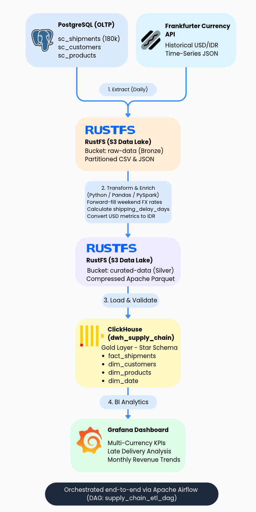
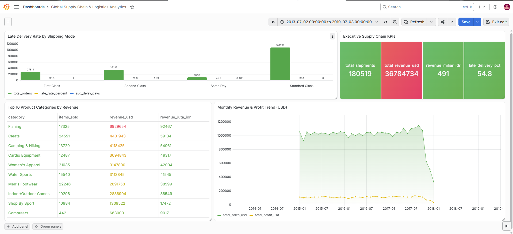

# End-to-End Global Supply Chain & Multi-Currency ELT Pipeline


-orange)


An end-to-end, containerized **Hybrid ELT Data Engineering Pipeline** processing **180,519 global supply chain shipment records** (DataCo Dataset) enriched with historical **USD-to-IDR exchange rates** from the Frankfurter REST API.

Built to mirror production-grade data platform architecture locally using **Docker**, **S3-compatible Object Storage (Medallion Architecture)**, **Star Schema OLAP modeling**, **automated data quality gates**, and **executive BI visualization**.

---

## Architecture Overview

<p align="center">
  
</p>

-----------------------+       +-------------------------+
|   PostgreSQL (OLTP)   |       | Frankfurter Currency API|
|  - sc_shipments (180k)|       |  - Historical USD/IDR   |
|  - sc_customers       |       |  - Time-Series JSON     |
|  - sc_products        |       +------------+------------+
+-----------+-----------+                    |
            |                                |
            +---------------+----------------+
                            |  [1. Extract (Daily)]
                            v
            +-------------------------------+
            |      RustFS (S3 Data Lake)    |
            |  Bucket: raw-data (Bronze)    |
            |  - Partitioned CSV & JSON     |
            +---------------+---------------+
                            |
                            |  [2. Transform & Enrich]
                            |  (Python / Pandas / PySpark)
                            |  - Forward-fill weekend FX rates
                            |  - Calculate shipping_delay_days
                            |  - Convert USD metrics to IDR
                            v
            +-------------------------------+
            |      RustFS (S3 Data Lake)    |
            |  Bucket: curated-data (Silver)|
            |  - Compressed Apache Parquet  |
            +---------------+---------------+
                            |
                            |  [3. Load & Validate]
                            v
            +-------------------------------+
            |  ClickHouse (dwh_supply_chain)|
            |  Gold Layer - Star Schema     |
            |  - fact_shipments             |
            |  - dim_customers              |
            |  - dim_products               |
            |  - dim_date                   |
            +---------------+---------------+
                            |
                            |  [4. BI Analytics]
                            v
            +-------------------------------+
            |       Grafana Dashboard       |
            |  - Multi-Currency KPIs        |
            |  - Late Delivery Analysis     |
            |  - Monthly Revenue Trends     |
            +-------------------------------+

   * Orchestrated end-to-end via Apache Airflow (DAG: supply_chain_etl_dag)
```

---

## Tech Stack & Component Roles

| Layer | Technology | Role in Pipeline |
| :--- | :--- | :--- |
| **Transactional Source (OLTP)** | **PostgreSQL 15** | Stores normalized operational supply chain tables (`sc_shipments`, `sc_customers`, `sc_products`) decoupled from heavy analytical workloads. |
| **External Enrichment API** | **Frankfurter REST API** | Provides historical daily `USD` to `IDR` reference exchange rates covering 2015-2018. |
| **Object Storage (Data Lake)** | **RustFS (S3-Compatible)** | Implements Medallion storage layers: `raw-data` (**Bronze**) for immutable raw snapshots and `curated-data` (**Silver**) for typed Apache Parquet files. |
| **Processing & Transformation** | **Python / Pandas / PySpark** | Cleanses records, performs calendar alignment with forward-fill (`ffill`) for non-trading weekend FX rates, engineers delay metrics, and computes IDR financials. |
| **Analytical Warehouse (OLAP)** | **ClickHouse** | Serves the **Gold Layer** (`dwh_supply_chain`) using a Star Schema and `ReplacingMergeTree` engines for idempotent deduplication and sub-second aggregations. |
| **Workflow Orchestration** | **Apache Airflow 2.10** | Schedules and enforces task dependencies (`extract` -> `transform` -> `validate`) with automated retries and logging. |
| **Business Intelligence (BI)** | **Grafana** | Connects directly to ClickHouse to visualize executive KPIs, delivery SLA bottlenecks, and revenue trends. |

---

## Data Modeling (Star Schema in ClickHouse)

The Data Warehouse (`dwh_supply_chain`) follows dimensional modeling principles optimized for analytical queries:

* **`fact_shipments` (`ReplacingMergeTree`)**: Grain at one row per shipment item (`180,519` rows). Stores foreign keys (`customer_id`, `product_id`, `order_date`), shipping metrics (`scheduled_shipping_days`, `actual_shipping_days`, `shipping_delay_days`, `is_late_delivery`), and multi-currency measures (`sales_usd`, `profit_usd`, `usd_to_idr_rate`, `sales_idr`, `profit_idr`).
* **`dim_customers`**: Customer segmentation (`Consumer`, `Corporate`, `Home Office`), market region, country, and city attributes.
* **`dim_products`**: Product catalog hierarchy (`product_id`, `product_name`, `category_name`, `department_name`).
* **`dim_date`**: Calendar dimension (`order_date`, `year`, `quarter`, `month`, `month_name`, `day_of_week`) enabling fast time-series rollups.

---

## Key Data Engineering Practices Implemented

1. **Source Decoupling & Replayability:** Extracting raw snapshots to `raw-data` in RustFS protects the operational PostgreSQL database from analytical query pressure and allows historical reprocessing without re-querying external APIs.
2. **Idempotent Pipeline Execution:** Utilizing ClickHouse `ReplacingMergeTree` engine and partitioned object storage paths ensures re-running DAG tasks produces consistent row counts without duplicate records.
3. **Time-Series Gap Handling:** Financial markets do not publish FX rates on weekends/holidays. The transformation pipeline generates a continuous date spine and applies forward-fill imputation so weekend shipments inherit the latest valid Friday closing rate.
4. **Automated Data Quality Gates:** Post-load validation tasks verify row-count parity (`180,519` source vs. warehouse records), check for null currency conversions, and confirm non-negative financial totals before marking the DAG run successful.

---

## Executive BI Dashboard (Grafana)



Key business insights surfaced by the dashboard:
* **Total Revenue & Profit (Dual Currency):** `$36.78M USD` (`~Rp 491B IDR`) across `180.5K` total shipments.
* **Delivery SLA Bottlenecks:** `54.8%` overall late delivery rate, highlighting severe delays in *First Class* (`95.3%`) and *Second Class* (`76.6%`) shipping modes.
* **Top Performing Categories:** *Fishing*, *Cleats*, and *Camping & Hiking* lead overall revenue generation.

---

## Project Structure

```text
hybrid-data-pipeline/
├── dags/
│   └── supply_chain_etl_dag.py      # Airflow DAG orchestrating extract, transform & validation
├── scripts/
│   ├── init_infrastructure.py       # Initializes RustFS buckets & ClickHouse Star Schema DDL
│   ├── seed_postgres_supply_chain.py # Seeds 180,519 DataCo records into PostgreSQL OLTP
│   ├── extract_postgres_to_lake.py  # Extracts normalized OLTP tables to RustFS (Bronze)
│   └── extract_api_to_lake.py       # Fetches historical USD/IDR rates from Frankfurter API
├── spark_jobs/
│   └── transform_supply_chain.py    # Cleanses data, forward-fills FX rates & loads Gold DWH
├── docs/
│   └── grafana_dashboard.png        # Executive dashboard screenshot
├── docker-compose.yml               # Multi-container infrastructure definition
├── requirements.txt                 # Python dependencies
├── .gitignore
└── README.md
```

---

## Quickstart Guide

1. **Start Infrastructure Containers:**
   ```bash
   docker compose up -d
   ```
2. **Start Local ClickHouse Server (WSL2):**
   ```bash
   clickhousectl local server start
   ```
3. **Trigger the ETL Pipeline:**
   * Open Apache Airflow at `http://localhost:8080`
   * Unpause and trigger **`supply_chain_etl_dag`**
4. **Explore Data & Dashboard:**
   * **Grafana BI Dashboard:** `http://localhost:3000`
   * **RustFS S3 Console:** `http://localhost:9001`
   * **ClickHouse / PostgreSQL SQL Client:** Connect via DBeaver (`localhost:8123` & `localhost:5432`)
